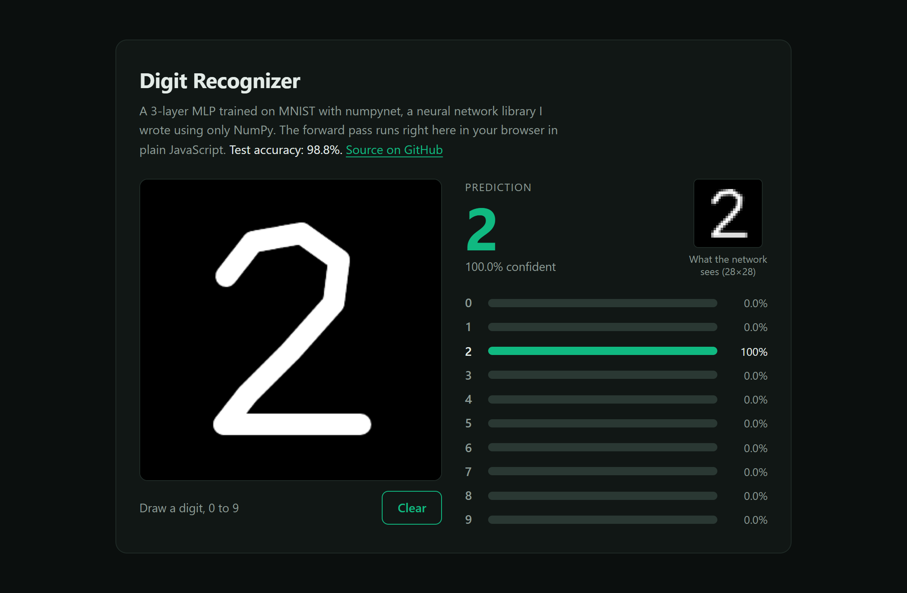
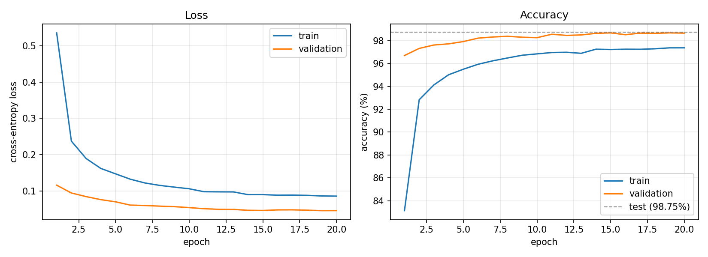
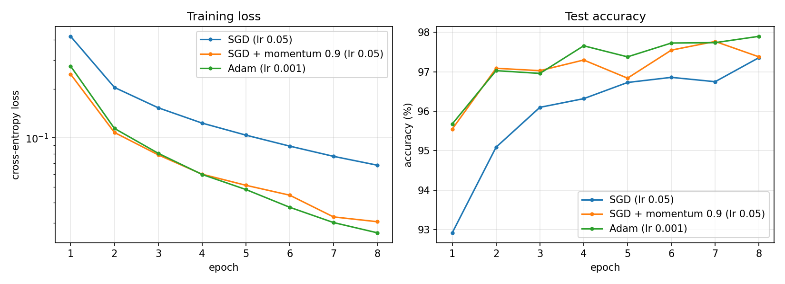

# numpynet

A small neural network library written from scratch with nothing but NumPy. No PyTorch, no TensorFlow, no autograd. Every forward pass, every gradient and every optimizer update is written out by hand, and the gradients are verified numerically.

Trained on MNIST it reaches **98.75% test accuracy** with a plain 3-layer MLP in under four minutes on a laptop CPU.

**[Try the live demo](https://om-patel88.github.io/numpy-neural-net/)**: draw a digit and the trained network classifies it in your browser.



## Why I built this

I had used PyTorch in courses but `loss.backward()` always felt like a black box. I wanted to derive backprop myself, implement it, and prove the implementation is right instead of just trusting that the loss goes down. Writing the gradient checker first and making each layer pass it before moving on turned out to be the most useful part of the project.

## What's in it

| | |
|---|---|
| Layers | `Dense`, `Dropout` (inverted), `BatchNorm`, `Flatten` |
| Activations | `ReLU`, `LeakyReLU`, `Sigmoid`, `Tanh`, `softmax` |
| Losses | `MSE`, `SoftmaxCrossEntropy` (fused, works on raw logits) |
| Optimizers | `SGD`, SGD with momentum / Nesterov, `Adam`, all with optional weight decay |
| Model | `Sequential` with train/eval modes, batched `predict`, save/load to `.npz` |
| Training | `fit` loop with minibatching, validation and history tracking |
| Verification | numerical gradient checking for single layers and whole networks |
| Data | MNIST downloader and idx parser, random shift augmentation |

## Quick start

```bash
git clone https://github.com/Om-Patel88/numpy-neural-net.git
cd numpy-neural-net
pip install -r requirements.txt
python -m pytest -q
python examples/train_mnist.py
```

The first run downloads MNIST (about 11 MB) into `data/`.

Building and training a model looks like this:

```python
import numpy as np
from numpynet import Sequential, Dense, ReLU, Dropout, SoftmaxCrossEntropy, Adam, fit
from numpynet.data import load_mnist

X_train, y_train, X_test, y_test = load_mnist()

model = Sequential([
    Dense(784, 256), ReLU(), Dropout(0.2),
    Dense(256, 128), ReLU(), Dropout(0.2),
    Dense(128, 10),
]).astype(np.float32)

history = fit(model, SoftmaxCrossEntropy(), Adam(model.params(), lr=1e-3),
              X_train, y_train, epochs=10, batch_size=64,
              val_data=(X_test, y_test))
```

## Results on MNIST

Model: 784 → 256 → 128 → 10 with ReLU and dropout 0.2 (235,146 parameters). Adam at lr 1e-3 decayed by 0.85 per epoch, batch size 64, 20 epochs, with each training image randomly shifted by up to 2 pixels every epoch. 55,000 images for training, 5,000 held out for validation.

| | Loss | Accuracy |
|---|---|---|
| Validation (5,000) | 0.0458 | 98.66% |
| **Test (10,000)** | **0.0393** | **98.75%** |



Training accuracy sits below validation accuracy the whole way. That is expected here: the training numbers are measured with dropout switched on and on shifted images, while validation uses the clean images with dropout off.

Reproduce with `python examples/train_mnist.py` (seed 0). Total training time was 225 seconds on my laptop.

### Optimizer comparison

Same network (784 → 128 → 64 → 10), same initial weights, 8 epochs each:



| Optimizer | Final train loss | Test accuracy |
|---|---|---|
| SGD, lr 0.05 | 0.0680 | 97.36% |
| SGD + momentum 0.9, lr 0.05 | 0.0306 | 97.38% |
| Adam, lr 0.001 | 0.0261 | 97.90% |

Momentum and Adam both drive the training loss down much faster than plain SGD. Run it with `python examples/compare_optimizers.py`.

## How backprop is structured

Every layer implements two methods:

```python
def forward(self, x):      # compute the output, cache what backward will need
def backward(self, grad):  # grad is dLoss/dOutput
                           # store dLoss/dParams, return dLoss/dInput
```

`Sequential.backward` just walks the layers in reverse and hands each one the gradient coming out of the layer after it. For a dense layer `y = xW + b` that works out to:

```python
self.W.grad[...] = self.x.T @ grad
self.b.grad[...] = grad.sum(axis=0)
return grad @ self.W.data.T
```

Softmax and cross-entropy are fused into one loss on purpose. Chaining them separately means building the full softmax Jacobian, while together the gradient with respect to the logits collapses to `(softmax(z) - y) / N`, which is both simpler and numerically stable. The loss itself uses the log-sum-exp trick so large logits don't overflow.

## Gradient checking

Analytic gradients are compared against central differences:

```
df/dx ≈ (f(x + ε) - f(x - ε)) / 2ε
```

`check_layer` does this for one layer's input and parameters, and `check_model` does it for every parameter of a full network plus loss:

```python
from numpynet import check_model

errors = check_model(model, SoftmaxCrossEntropy(), x, y)
# {'layer0.W': 3.9e-08, 'layer0.b': 1.2e-09, ...}
```

The test suite checks every layer, activation and loss this way in float64 and requires a relative error below 1e-6. The worst case across the suite is about 4e-8.

Two things I ran into that are worth knowing about:

- ReLU has a kink at zero, so a finite difference that straddles it gives the wrong answer. The tests keep inputs away from zero for that reason.
- The bias of a dense layer that feeds straight into batch norm has a true gradient of exactly zero, because batch norm subtracts the batch mean. A relative error on a zero gradient is just noise, so that parameter is checked against an absolute tolerance instead.

## The browser demo

`docs/` is a static page with no dependencies. `train_mnist.py --export` writes the trained weights as raw float32 (`weights.bin`) with a small `model.json` describing the layer sizes, and `app.js` re-implements the forward pass in about 15 lines of JavaScript. Over the first 300 test images the JavaScript logits match NumPy's to within 1e-5.

The part that matters most for accuracy is preprocessing. MNIST digits were size-normalised into a 20×20 box and centred by centre of mass in a 28×28 image, so the page does the same to whatever you draw: crop to the ink, scale the longer side to 20 pixels, then shift so the centre of mass lands in the middle. Without that step a digit drawn in a corner is classified badly. The small preview next to the prediction shows exactly what the network receives.

To run it locally:

```bash
python -m http.server 8000 --directory docs
```

## Project layout

```
numpynet/
  layers.py        Parameter, Layer, Dense, Dropout, BatchNorm, Flatten
  activations.py   ReLU, LeakyReLU, Sigmoid, Tanh, softmax
  losses.py        MSE, SoftmaxCrossEntropy
  optimizers.py    SGD, Adam
  model.py         Sequential
  trainer.py       fit, evaluate, minibatching
  gradcheck.py     numerical gradient checking
  data.py          MNIST loader, shift augmentation
tests/             65 tests: gradients, layers, optimizers, end-to-end training
examples/          MNIST training and optimizer comparison scripts
docs/              in-browser demo
```

## Things I'd add next

- `Conv2D` and `MaxPool2D` using im2col, which should push MNIST past 99%
- Learning rate schedulers as proper objects instead of a line in the training script
- A small reverse-mode autograd engine so new layers don't need a hand-written backward pass

## License

MIT
